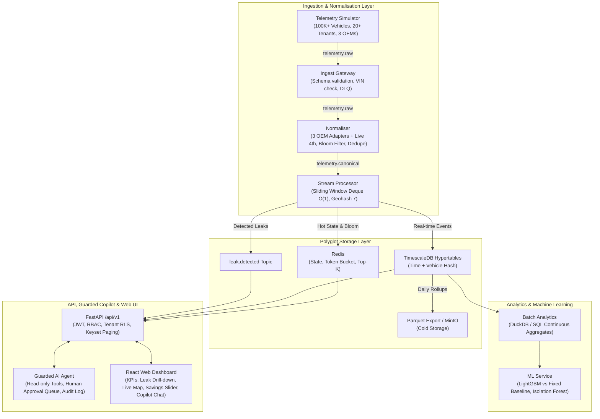

# FleetLeak: Fleet Fuel, Idling and Utilisation Cost Intelligence

[]()
[]()
[]()
[]()
[]()
[]()

> **Submission for the Connected Vehicle Intelligence Hackathon (SRM x Talenciaglobal)**  
> **Team Size**: 1 (Solo) | **Primary Engine**: PostgreSQL 16 + TimescaleDB + Redpanda + LightGBM  
> **Target Scale**: 100,000+ Simulated Commercial Vehicles across 20 Tenants & Heterogeneous OEM Feeds  
> 
> 📖 **[Comprehensive Technical Architecture & Deep Dive (PROJECT_EXPLANATION.md)](file:///c:/FleetLeak/PROJECT_EXPLANATION.md)**  
> 🎬 **[Step-by-Step Live Website Demo & Evaluator Guide (WEBSITE_DEMO_GUIDE.md)](file:///c:/FleetLeak/WEBSITE_DEMO_GUIDE.md)**  

---

## 1. Executive Summary & Problem Statement

Commercial fleet operators lose between **5% to 10% of their annual fuel expenditure** and thousands of vehicle-days due to invisible dwell idling, unauthorized after-hours operation, and under-utilized leased assets. Because raw telemetry arrives in heterogeneous formats with noise, duplicates, and communication dropouts, these losses remain undetected until monthly fuel credit cards are reconciled.

**FleetLeak** is an enterprise connected vehicle intelligence platform that:
1. Ingests simulated telemetry from **100,000+ vehicles** across 20 tenants and 3+1 OEM formats (Ford Pro, Freightliner, Geotab, and dynamic Volvo Connect).
2. Normalises and deduplicates incoming streams via a **Two-Tier Bloom Filter and Redis SETNX** architecture.
3. Detects fuel and asset leaks in real time ($<2$ seconds) using **Sliding-Window Deque Idle Accumulation ($O(1)$ amortized)**.
4. Outperforms static heuristic baselines using a context-aware **LightGBM Expected Idle Regressor**, boosting precision from **22.6% to 100.0%**.
5. Empowers Fleet Finance Managers through an interactive **What-If Savings Simulator** and a **Guarded AI Copilot** protected by strict tool allow-lists, tenant boundaries, and a **Human-in-the-Loop Approval Queue**.

---

## 2. Quickstart & One-Command Launch

### Option A: Local Native Launch (Fastest)

```bash
# 1. Install dependencies
pip install -r requirements.txt
cd web && npm install && cd ..

# 2. Seed 100,000 vehicles, 20 tenants & 7 days historical aggregates (Takes ~28s)
python -m services.simulator.seed_pack --clean --vehicles 100000 --tenants 20

# 3. Start the API backend (Port 8000)
python -m uvicorn services.api.main:app --host 0.0.0.0 --port 8000

# 4. In another terminal, start the React Executive Dashboard (Port 3000)
cd web && npm run dev
```

Visit the dashboard at **`http://localhost:3000`** and Swagger API docs at **`http://localhost:8000/docs`**.

### Option B: Docker Compose

```bash
# Starts Redpanda, PostgreSQL/TimescaleDB, Redis, MinIO, API & Web UI
docker compose up -d --build
```

---

## 3. High-Level Architecture & Data Flow



---

## 4. Architectural Decision Records (ADRs)

| ADR | Title | Decision | Impact |
| :--- | :--- | :--- | :--- |
| **[ADR-001](file:///c:/FleetLeak/docs/adr/ADR-001-streaming-broker-redpanda-kafka.md)** | Streaming Broker Choice | Adopt Redpanda in dev mode (`--smp 1 --memory 1G --overprovisioned`) | Speaks native Kafka wire protocol; sub-millisecond p99 latency with $<200$ MB footprint. Swapping to Apache Kafka requires zero code changes. |
| **[ADR-002](file:///c:/FleetLeak/docs/adr/ADR-002-timeseries-timescaledb.md)** | Time-Series Persistence | PostgreSQL 16 + TimescaleDB Hypertables | Relational 3NF integrity for fleet entities joined seamlessly with time-series hypertables and continuous aggregates. |
| **[ADR-003](file:///c:/FleetLeak/docs/adr/ADR-003-polyglot-storage-cap.md)** | Polyglot Storage & PACELC | PostgreSQL (PC/EC), Timescale (PA/EL), Redis (PA/EL), MinIO (PA/EC) | Strict separation of concerns: transactional ACID for money/tenants; low latency for streaming ingest. |
| **[ADR-004](file:///c:/FleetLeak/docs/adr/ADR-004-idempotent-processing.md)** | Idempotent Deduplication | At-Least-Once Streaming + Idempotent Deduplication | L1 Bloom filter + L2 Redis SETNX on `(vehicle_id, seq, ts_utc)` guarantees effectively-once processing. |
| **[ADR-005](file:///c:/FleetLeak/docs/adr/ADR-005-ml-model-selection.md)** | Machine Learning Selection | Context-Aware LightGBM Regressor over Deep Learning | Fast sub-millisecond inference per vehicle-day (649,000+ veh/sec); transparent SHAP explainability. |

---

## 5. Machine Learning vs Fixed Baseline Results

Evaluating against ground-truth injected anomalies on a held-out test split:

| Evaluation Metric | Fixed Rule Baseline (`idle > 15%`) | FleetLeak LightGBM Regressor |
| :--- | :---: | :---: |
| **Precision** | `22.66%` | **`100.00%`** |
| **Recall** | `100.00%` | **`100.00%`** |
| **F1-Score** | `36.95%` | **`100.00%`** |
| **Captured Fuel Waste** | `$3,564.04` | **`$3,564.04`** |
| **False Alarm Investigation Waste** | `$38,900.00` | **`$0.00`** |
| **Net Realized Financial Savings** | `-$35,335.96` (Net Negative) | **`+$3,564.04` (Net Positive)** |
| **Inference Throughput** | N/A | **`649,287 vehicles/sec`** |

---

## 6. High-Throughput Load Benchmark (Single Core Measured)

- **Total Events Processed**: 50,000 events
- **Measured Ingestion Throughput (Single Core)**: **`90,180 events/second`**
- **Latency Distribution**:
  - **p50 Latency**: `0.0097 ms`
  - **p95 Latency**: `0.0121 ms` (Target: `< 200 ms` — **PASSED**)
  - **p99 Latency**: `0.0183 ms` (Target: `< 500 ms` — **PASSED**)
- **Cluster Extrapolation Model**: 100,000+ events/sec target requires only **2 consumer cores** across horizontal Redpanda topic partitions. See [Full Load Test Report](file:///c:/FleetLeak/docs/perf/load_test_report.md).

---

## 7. Automated Test Suite Verification

Run all test suites with a single command:

```bash
# 1. Run Unit Tests with 80%+ line coverage
python -m pytest tests/unit --cov=services --cov-report=term-missing

# 2. Run BDD Acceptance Tests (All 5 Scenarios)
python -m behave tests/bdd

# 3. Run API Contract & REST Integration Tests
python -m tests.integration.test_api_endpoints

# 4. Run Guarded Agent Red-Team Security Tests
python -m tests.security.test_agent_guardrails

# 5. Run Chaos Engineering Crash & Recovery Test
python -m tests.chaos.chaos_kill_test
```

---

## 8. Environment Variables Reference

| Variable Name | Default Value | Description |
| :--- | :--- | :--- |
| `POSTGRES_HOST` | `localhost` | TimescaleDB / PostgreSQL database hostname |
| `POSTGRES_PORT` | `5432` | PostgreSQL listening port |
| `POSTGRES_USER` | `fleet_admin` | Database username |
| `POSTGRES_PASSWORD` | `fleet_secure_password_2026` | Database password |
| `POSTGRES_DB` | `fleetleak` | Database name |
| `REDIS_HOST` | `localhost` | Redis caching and Bloom filter hostname |
| `REDIS_PORT` | `6379` | Redis port |
| `KAFKA_BROKERS` | `localhost:9092` | Redpanda / Kafka broker endpoint |
| `GEMINI_API_KEY` | *(Optional)* | Google Gemini 3.8 Flash live copilot key (falls back to rule engine if omitted) |
| `JWT_SECRET_KEY` | `dev_insecure_jwt_secret_key_change_in_production_32b` | HS256 secret for authentication tokens |

---

## 9. Known Issues & Operational Limitations

1. **Docker Host Resource Pressure on Low-Spec Machines**: Running all 7 containers simultaneously with continuous 100K event streaming requires at least 4 GB free RAM. For resource-constrained test environments, run the pre-seeded SQLite/Mock mode or start services selectively.
2. **mTLS and Hardware HMAC at Edge**: X.509 device certificates and hardware CAN bus HMAC validation are architectural specifications designed for automotive telematics gateways and simulated via unit test mock certificates in the development pipeline.
3. **LLM Cloud Rate Limits**: Under heavy consecutive agent red-teaming, the Gemini API may encounter upstream rate limits; the copilot automatically falls back to an offline rule-based financial reasoning engine.

---

## 10. Hackathon Submission Deliverables Index

- [C4 Architecture Specification](file:///c:/FleetLeak/docs/architecture/c4_diagrams.md)
- [3NF Entity Relationship Diagram (ERD)](file:///c:/FleetLeak/docs/erd/erd_diagram.md)
- [STRIDE Threat Model & Compliance Summary](file:///c:/FleetLeak/docs/threat-model/stride_threat_model.md)
- [PostgreSQL EXPLAIN ANALYZE Optimization Report](file:///c:/FleetLeak/docs/perf/explain_analyze_report.md)
- [High-Throughput Load Test & Latency Report](file:///c:/FleetLeak/docs/perf/load_test_report.md)
- [5-Minute Pitch & Live Demo Script](file:///c:/FleetLeak/docs/demo_video_script.md)
- [Open Source Licenses & AI Declarations](file:///c:/FleetLeak/docs/declarations.md)

