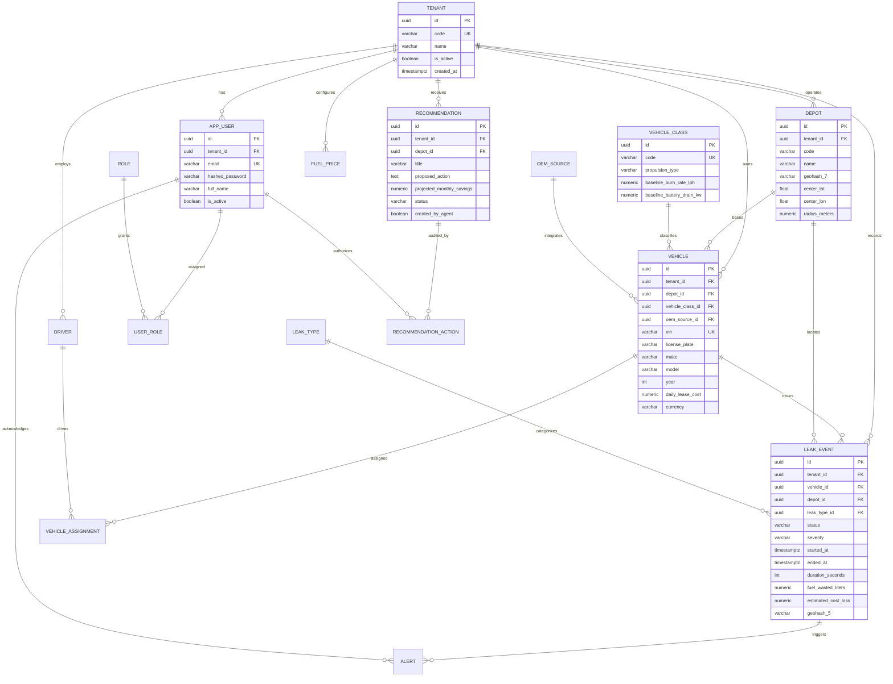

# FleetLeak 3NF Relational Entity-Relationship Diagram

In accordance with Docket Section 6.2 and 6.6, the core schema strictly adheres to Third Normal Form (3NF) with surrogate UUID primary keys, explicit foreign key cascade rules, check constraints, and row-level security.

